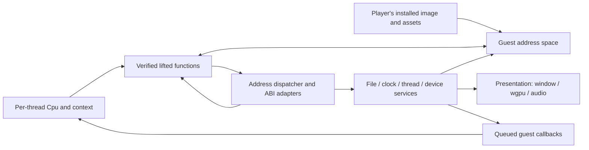

# Phase 1 runtime proposal (R01)

## L109 loading telemetry

ReadFileEx optionally caches immutable install archives with
`DDRUNTIME_FILE_READ_AHEAD=1`: 256 KiB forward windows, 8 MiB retained
buffer capacity per runtime, overlay/writable files excluded. It remains
off by default: warm sequential 128 KiB reads regressed, although small
and repeated ranges improved. Loading logs include cache hit/miss/fetched
byte counters and all-zlib counters alongside archive-scoped inflate.
Head's instr1 baseline records 4.854 s archive inflate before the movie
opens, versus 0.056 s file-read and 0.007 s pipeline time at that sample.
UI phase boundaries and a paired post-port run remain with head.

The archive zlib fast loop (`0x00cf2cb0`) is a readable runtime port,
verified against 559 original-instruction vectors including state,
output, registers, flags and stack spills. The original outer inflate and
archive streaming functions still handle checksums, buffers and callbacks.
`DDRUNTIME_ARCHIVE_INFLATE=0` selects the generated leaf for A/B runs;
explicit mods at that address retain precedence. Isolated leaf timings
improved 2.30–8.06x; whole-game loading is awaiting head comparison.

`DDRUNTIME_LOAD_LOG=1` adds process-relative startup/movie/file/archive/GPU
timing and frame counters. `scripts/load_timeline.py` produces a timeline;
UI milestones require explicit head-observed timestamps. Service totals
are inclusive across threads, not additive wall-time phases. Archive
wrappers retain original code and registered overrides. See
[timing boundaries and validation](tasks/L109-loading.md). ReadFile and
ReadFileEx reuse bounded per-thread host scratch for requests up to 128 KiB;
by default they still read the file every time. Synthetic warm 128 KiB service time
was 11.569 -> 9.643 us/call, allocations 1 -> 0. Whole-game phase timings
remain pending head runs.

## L82 render service tails (2026-10-13)

**Input convoy follow-up:** GetAsyncKeyState/GetKeyState and the stateless
GetKeyboardLayout/MapVirtualKeyA/ImmGetVirtualKey queries are LockFree.
The host's EventSender atomically publishes pending input; unchanged polls
read accepted-key snapshots. Pending events still pump under `with_lock`
so hook suppression and hook-thread ordering remain intact. Modifier
families share one atomic word for exact pressed-bit consumption.
GetKeyState snapshots are per-session/per-guest-thread and update only on
message removal (including toggles). XInput/DirectInput mutations retain
their existing locks. The snapshot-map mutex is used only on cache misses.
Busy-worker scenario: 32 polls, **32 -> 0 acquisitions/blocks**, **4.461 ms
-> 15.003 us/call**; full **141 light tests pass**. Head must measure gameplay
and build the host integration; the agent neither built shards nor ran the
game. Details and limits are in the L82 task Results.

`Binding::ServiceTail` preserves locked preparation and the existing
backend-mutex submission order for DrawPrimitive, DrawIndexedPrimitive and
Clear (device slots 81/82/43). Their final `unlocked` section no longer
reacquires merely for CPU/stack return. All unlocked calls in a service
must satisfy this contract before assigning the policy. UP methods still
reacquire for binding/reference updates. Nested and serial services retain
their caller's lock; the step executor uses the same policy as dispatch.
Device state remains shared `GuestCell` data and is not generally lock-free.

`DDRUNTIME_LOCK_STATS=1` reports each thread's services per Present interval,
contended calls, condition-variable blocks, wait and service time, plus
waiting-thread/service to holding-thread/service edges in `lock_stats()`.
Present failures also delimit an interval; initialization belongs to the
first interval, and nested timings are inclusive. Parallel acquisitions
also avoid enabling the serial-preemption hook which already returns
without yielding in that mode.

Synthetic 32-call contention: acquisitions **64 -> 32**, blocks **32 -> 0**,
mean service **4.479 ms -> 71.496 us** (instrumented debug scenario, not FPS).
**138 light tests pass**, including real headless COM acquisition counts and
recorded output. No gameplay comparison yet. Head redirected the next L82
batch to the measured GetAsyncKeyState polling convoy; see
`docs/tasks/L82-render-lock.md`.

**For head review; no runtime implementation is authorized by this document.**
Baseline: `9091c6c`, 2026-10-11, DDDA.exe 2017-12-13 Steam. The head reports
31,590 verified functions, 62.6% of inventoried functions and 72.7% of code
bytes. The actual lifted list contains **31,580** entries, of which **14,186**
are closed and **17,394** use external calls. The ten additional verified
entries belong to the inventory's wider verification set, not this lift
list. These figures do **not** establish that startup can run.

The proposed runtime keeps the original guest objects and frame order,
executes verified Rust translations, and implements OS/device boundaries
explicitly. Start with checked guest memory and diagnostic execution.
Do not make missing calls succeed, replay test return values in production,
or substitute the existing scripted opening for original startup.

The largest newly identified prerequisite is the static initializer list:
**5,656 non-null targets, 5,651 absent from the function inventory**. The
CRT invokes these before WinMain; many initialize game state. The broad
`>= 0x012E0000` platform classification is unsuitable as a runtime binding
policy. See the initializer evidence and gates below.

## Evidence and limits

- **Measured:** the read-only inventory database and `calls.tsv`, the shared
  `patterns/lift.json`, installed PE bytes, and Capstone disassembly of the
  private analysis copy. Addresses below refer to that build. Private
  reports live in `E:/ddda-re/notes/runtime-R01/`; no exports or bytes are
  included here.
- **Prior evidence:** [FRAME.md](FRAME.md) records executable addresses and
  live confirmation of frame/line order. [METHODOLOGY.md](METHODOLOGY.md)
  defines Phase 1 and executable identity. These are identified where used.
- **Repo evidence:** source paths identify current interface behavior;
  there is no executable address for a Rust-only design choice.
- **Proposed** means a decision for review, not observed original behavior.
  **Unconfirmed** means the evidence does not yet establish the claim.
- Ghidra MCP was unavailable: `127.0.0.1:8089` refused connections and no
  callable Ghidra tool was exposed in this session. Importing the local
  bridge to call `connect_instance("DDDA")` also failed because that Python
  environment lacks `mcp`. No server restart, canonical project edit,
  rename, import, deletion or script endpoint was attempted. This plan uses
  disassembly rather than claiming a new Ghidra decompilation review.
- Static reachability counts potential dependencies, not executions or
  call frequencies. No original-game boot trace or runtime benchmark was
  made in R01. A missing sparse fixture is not an unsupported instruction.

## Decisions proposed for approval

| Area | Proposed decision | Reason and prerequisite |
|---|---|---|
| Address space | Reserve a 4 GiB guest arena in a 64-bit process; commit regions on demand; retain access checks initially | Guest pointers remain u32. The original `.data` has a zero-filled tail and runtime globals; `Mem` currently wraps byte addresses. A reservation alone does not make all reads valid. |
| Ownership | One guest process/session owns image, heap, handles and shared objects; one `Cpu` and thread context per guest thread | Thread creation is present in `0x0041B400`, `0x00DB1A50`, `0x00DBB690`, among others. |
| Dispatch | Immutable address-to-binding registry for all verified lifted entries, approved ABI adapters and platform services | The ext classification describes test boundaries, not a reason to disable a translated production function. Unknown target is a terminal diagnostic. |
| Execution | Host threads with separate memory-access handles and synchronized shared backing for the first correctness implementation | Avoid aliasing one `&mut Mem` between threads. Do not pretend a synchronous callback loop implements all guest thread waits. Parallel fast memory is a later measured optimization. |
| Boot | Replace the CRT shell with an audited startup driver, retaining every required initializer and game call in its observed order | SEH/TLS/CRT helpers need platform contracts; the initializer list cannot be skipped. WinMain is `0x004079E0`. |
| Graphics | Target a D3D9 object/command compatibility boundary backed by wgpu; do not replace the entire frame renderer with `ddview` scene construction | Keeps original render selection/order around `0x00DB1960` and `0x00DAF000`. Shader conversion and device-state coverage are substantial new work. A higher-level boundary requires a separate equivalence proof. |
| Integration | Keep simulation ownership in the runtime; reuse readers and presentation components selectively | Existing `ddhost`/`ddview` route logic is not another authority over the same guest objects. |



The diagram is a proposal. Device callbacks must enter through the guest
dispatcher; native function pointers are never stored in guest objects.

Proposed code boundaries for later briefs: keep machine helpers and lifted
shards as they are; a headless `ddruntime` owns guest sessions, binding
manifests, thread contexts and service requests. A platform crate supplies
arena reservation, files, clocks and host thread/wait mechanisms. Window,
wgpu, audio and input backends live outside the simulation core, with
`ddview` consuming presentation commands. Dependency direction is platform
and presentation toward headless contracts; the core must not depend on
Bevy or poll OS input. These crate names are proposals, not new crates.

## 1. Memory, object sharing and machine state

### Image loading

The installed file's SHA-256 is
`19facc2642f79a09d14ce55eace5f228161f2f8bab60ec67eb3c6196cc6277b8`;
the analysis copy's is
`a1831a438685c50ca530bbb91dc4cbdc36449ffa7d9183e345a8a106782286b5`.
R01 compared the complete raw contents of corresponding sections: `.text`,
`.rdata`, `.data`, `.rsrc` are identical, as are all 273 normal imports.
This strengthens the table-specific checks described by `ddexe`.

| Section | Guest VA | File bytes | Virtual bytes (PE header) |
|---|---:|---:|---:|
| `.text` | `0x00401000` | 16,367,104 | 16,367,099 |
| `.rdata` | `0x0139D000` | 2,636,288 | 2,636,177 |
| `.data` | `0x01621000` | 2,446,848 | 3,711,456 |
| `.rsrc` | `0x019AC000` | 256,000 | 255,736 |

Load the player's file, validate identity/layout, map headers and sections
at **guest** VAs based on `0x00400000`, and zero virtual tails. Preserve
the loader's page-rounded raw/virtual span handling; do not read BSS from
the file. `ddexe::Exe::bytes` deliberately covers only file-backed data
and is therefore a parser to reuse, not a complete process loader.
The analysis PE has no base-relocation or static TLS directory; it does
have a nonempty delay-import directory (directory 13). Normal import
counts below exclude delayed/dynamically requested interfaces. Audit and
bind those before any runtime claims completeness.

The installed PE entry is `0x019EB310`; the analysis entry is
`0x012EFA14`. The runtime must not use the installed wrapper entry as a
lifted program entry. Read installed image/data bytes and execute the
reviewed Rust program's startup contract. No x86 image page needs host
execute permission. Proposed IAT contents are guest binding tokens,
associated with DLL/name-or-ordinal and calling convention, not truncated
64-bit host pointers. Import stubs and delayed resolver paths must resolve
to the same binding identities.

### Arena choice and correctness costs

| Option | Cost/benefit | Decision |
|---|---|---|
| Reserved 4 GiB arena | Host address is `base + u32_address`; reservation is virtual, commitment follows actual use. Page permissions/guard regions can reject unmapped access. | Preferred backing; not a 4 GiB eagerly zeroed allocation. |
| Software page table | One or two lookups per access, cross-page handling, easier precise faults and dirty tracking; noncontiguous backing. | Keep as diagnostic/portable fallback and compare performance before discarding. |
| Sparse hash map | Existing `mem::Sparse` gives excellent missing-read diagnostics, but byte hashing and map writes dominate whole-game access. | Keep for fixtures, not production world memory. |
| Unchecked arena dereference | Cheapest address calculation, but invalid pointers, cross-boundary reads, permissions and data races can become host undefined behavior. | Not the initial implementation; requires an explicit safety and performance review. |

Windows supports reserving without committing physical storage; see
[VirtualAlloc](https://learn.microsoft.com/en-us/windows/win32/api/memoryapi/nf-memoryapi-virtualalloc).
This is an OS capability, not a measured runtime speedup. The size of the
original guest's heap/stack commitments is **unconfirmed**; do not reuse
the fixture's `HEAP_BASE=0x0C000000` or stack address as a production ABI.

Initial `Mem` accessors should check mapped/readable/writable spans, use
little-endian unaligned loads/stores, and implement the existing u32
wrapping semantics explicitly at `0xFFFFFFFF` rather than dereferencing
past the arena. Guard stacks and the null region, track allocation
lifetime/alignment and fail with thread/function/address/width. Guard
pages alone are not a recoverable Rust fault mechanism; the checked mode
must not depend on catching arbitrary access violations.

Current `Mem` scalar methods perform byte operations, and XMM transfers
are multiple u32 accesses (`crates/ddnative-base/src/mem.rs`,
`research/native/lift.py`). Upgrade scalar implementations as part of the
runtime without assuming four byte loads are a single atomic u32 load.
Memory `XCHG` is emitted as ordinary load/store today; LOCK-prefixed
mnemonics, CMPXCHG and XADD have no emitter implementation. A linear
inventory-span census found six XCHG candidates and no other listed
atomic opcode; that is **not proof of absence** outside those spans.
The executable also imports Interlocked operations (section 4), so atomic
service support is needed even if no new opcode is encountered.

**Proposed concurrency contract:** each host worker owns a distinct
`Mem` handle referencing shared, internally synchronized arena storage.
Never construct overlapping mutable Rust slices/references over that
storage. Initially lock each complete scalar access; use one lock for an
entire interlocked/XCHG operation. This avoids host data races and permits
correct API waits without retaining a global memory lock. It does not
promise the original scheduling or timing. Mixed-width and unaligned
atomic accesses need an explicitly tested policy, not casts to `AtomicU32`
over arbitrary bytes. A later fast implementation must account for every
overlapping access, ordinary as well as atomic, before relaxing locking.

Hand ports receive the same guest memory and addresses. Typed Rust values
are transient decoded views, not a second authoritative object graph;
write changes back through the same access contract. Use guest IDs or
generation-checked host handles for textures/files/voices. Never put Rust
references, Bevy entities or native handles into guest vtables/fields.
This preserves layouts such as `sApp+0x2558` and the sMain vtable set by
`0x0041B420`, without pretending a typed hand port is automatically ABI
compatible. Verified readable ports that replace lifted bodies
(crates/mtmath, docs/MATH.md) use the lifted ABI themselves and are bound
through the generated lifted program, so the dispatcher needs no special
case; ports that call unported code go through x86::call_ext like the
lifted bodies.

`Cpu` currently includes GPRs, XMMs, flags, DF and full x87 state, but no
explicit EIP or guest MXCSR. FS base is in Cpu; L27 initializes a per-thread
TEB and SEH chain. x87 state is preserved by
the helper; new SSE helpers use fixed MXCSR `0x1F80`. Before general boot,
audit guest control-word/MXCSR/FS accesses and add the required thread
state or reject them. D3D creation uses flags `0x46` or `0x26`
(`0x00DB192A`, `0x00DB194B`, call `0x00DB1960`), including FPU_PRESERVE;
it does not justify forcing every game thread to a guessed precision mode.
L27 adds bounded SEH search, nested dispatch and target-frame unwind.
L27b adds a separate per-instruction generated path with transactional Cpu/
memory checkpoints, explicit successors and exact interior instruction keys.
Registry/Session uses it for AV/#DE delivery and nonlocal service-callback
transfers. Light emitted fixtures and the Windows oracle pass; full game
regeneration/replay remains a train obligation. The selected-list audit still
misses 39 census filter/body entries; see [L27b Results](tasks/L27b-seh-faults.md#results).

## 2. Dispatcher and the measured boot frontier

### Binding contract

The production registry must include **all** 31,580 selected lifted
functions, not just the 14,186 closed functions installed by fixture
replay. This enables indirect calls to ext roots, recursion and callbacks;
it does not establish their callees or recursion bounds are implemented.
Use an immutable registry with an explicit, reviewed winner for each VA:
platform ABI replacement, whole-function hand adapter, or lifted body.
Reject duplicate/conflicting registrations. Inventory status `platform`
alone is never a binding. A documented or partially translated function
without a machine-state adapter remains missing.

The caller has already pushed the guest return address. Each adapter must
implement actual register arguments, memory effects, preserved registers,
return registers/x87, flags where observable, and `ret` stack cleanup.
cdecl, stdcall, thiscall, fastcall and compiler helpers are not interchangeable.
For example, WinMain consumes 16 stack-argument bytes (`0x00407AF4`), while
its `__alloca_probe` call at `0x004079EB` changes the stack by a requested
allocation, not an ordinary malloc-like return. Guest callbacks need a
reviewed entry frame and return sentinel. Tail calls reuse the caller's
return address; unknown interior targets must fail, not round to the
nearest function.

Two current source constraints must be fixed before wiring this registry:

1. `x86::call_ext` takes the handler out of thread-local `EXT` before calling
   it and reinstalls it afterward. A handler dispatching a function that
   calls `call_ext` again will find no handler; unwinding also skips restore.
   Replace this with reentrant immutable lookup and separately owned
   per-thread service context, and test nested callbacks and failure cleanup.
2. `lift.py::target` emits the five existing platform functions directly;
   same-shard and cross-shard lifted calls also bypass `call_ext`. Changing
   the ext registry cannot override these. Generate from a consistent
   production binding manifest or route replaceable services through a
   separate policy hook. Test and runtime binding policies must be distinct.

Current platform models are `0x00CF73F0`, `0x00DE0B80`, `0x00DE0B90`,
`0x012EFE20`, `0x012EFEA0` (`ddnative-base/src/platform.rs`). In particular,
the model at `0x00DE0B90` does not free memory. That fixture behavior must
not silently become the production allocator. Allocator object state,
alignment, failure and reuse require recorded contracts. Mock x87 return
push sites likewise are fixture metadata, not permission to fabricate a
float return when a real callee runs.

On an unknown target, stop with target VA, inventory name or `unknown`,
binding category, thread ID, call/return site, guest stack, registers and
recent block/service history. Current local `pc` variables are not exposed
as resumable continuations; add diagnostic function/block tracking. A
failure does not resume at an invented return. Emit an ordered frontier
report for the next implementation batch.

### Static measurements

`measure.py` traverses the exported caller/callee graph, deduplicating
edges. The main vtable is anchored by the constructor's store of
`0x0155ADC0` at `0x0041B420`; the measured augmentation adds slots 0..11
and the constructor as roots. It is a conservative root union, **not** a
claim every slot executes during boot.

| Root set | Known inventory entries | In lifted list | Absent from lifted list | Distinct internal edges to absent entries |
|---|---:|---:|---:|---:|
| WinMain `0x004079E0`, direct closure | 276 | 89 | 187 | 413 |
| Main loop `0x00DF0D20`, direct closure | 152 | 33 | 119 | 247 |
| Frame `0x0041DD60`, direct closure | 690 | 419 | 271 | 527 |
| CRT entry `0x012EFA14`, direct closure | 335 | 89 | 246 | 531 |
| WinMain + main ctor + main vtable slots 0..11 | 1,591 | 991 | 600 | 1,339 |

Of WinMain's 187 absent entries, 144 are inventory-labelled platform and
43 have other statuses. Two of the latter, memcpy/memset, already have
fixture models; an entry's absence from the lifted list does not by itself
mean no model exists. Conversely, 144 platform labels do not mean 144
implemented services. The direct closure has 90 targets outside the
function table, including export artefacts such as low external addresses;
do not treat those as executable guest entries. IAT decoding is separate.

The direct closure's linear-span census has 631 indirect call/jump sites.
It omits data-dependent targets and may include unreachable bytes because
Ghidra sizes are not exact spans (L07). For a broad sensitivity check,
scanning non-executable sections for aligned runs of at least four known
function pointers gives 2,042 **candidate pointer runs**, 26,557 distinct
targets; their graph closure plus the four roots gives 42,710 known
entries, 29,144 lifted, 13,566 absent. These runs include callback tables
and are **not a validated vtable catalogue or a boot bound**. Neither this
scan nor the call graph sees the 5,651 unknown initializer targets.

Therefore the answer to “how often will boot hit untranslated code?” is:
**dynamic frequency is unmeasured; hundreds of static dependencies lack
lifted entries, and required startup roots are absent entirely.** With
today's bindings, the proposed startup driver already stops on its first
non-null initializer `0x0137DFF0` (inventory platform, no lifted binding).
Starting directly at WinMain instead would encounter an unbound
`LoadLibraryA` import at `0x004079F6`. Neither is a boot success.

## 3. Entry, initializers and frame order

### Required boot sequence

| Order | Executable evidence | Runtime action / remaining question |
|---|---|---|
| PE setup | Image base `0x00400000`; sections above; entry `0x012EFA14` | Map image, BSS, guest stack and imported services before calling guest code. |
| CRT entry | `0x012EFA14` calls `___security_init_cookie` at `0x012FE372`, then jumps to `___tmainCRTStartup` at `0x012EF8A7` | Reproduce necessary CRT/TLS/cookie state through audited adapters; do not lift the platform shell blindly. |
| C initialization | `0x012EDA8A..0x012EDA94` passes `[0x014034B4,0x014034D0)` to `0x012EDA3A` | Six non-null C initializers; retain error propagation and order. Five of six are absent from inventory. |
| C++/game initialization | `0x012EDAAB..0x012EDAC9` walks `[0x0139D490,0x014034B0)` in four-byte steps, calling non-null entries | 104,456 slots, 5,656 non-null distinct entries, only five inventoried. Discover and verify bodies; never replace the whole list with zeros or a DTI-name reader. |
| WinMain | `0x012EF9BC` calls `0x004079E0` with image base, null previous instance, command line and show value | Explicit startup ABI. CRT exit paths at `0x012EF9C9`/`0x012EF9FF` are also services to model. |
| Front-door services | `0x004079F6` LoadLibraryA; `0x00407A20` SteamAPI_Init; failure branches `0x004079FE`, `0x00407A28` | Preserve actual success/failure and diagnostics. No unconditional-success Steam stub. |
| App and registration setup | `0x00407A67` calls sApp ctor `0x00DF3940`, then `0x00DF0B90`, `0x00740590`, `0x00740860`; ctor stores sApp global at `0x00DF3987` | Run game initializers before using singletons. Exact purpose of the two `0x0074...` routines is unconfirmed here; preserve their calls. |
| App initialization | `0x00407AB0` calls `0x00DF3AC0`; its calls include `0x00DF31F0`, `0x00DF1200`, virtual call at `0x00DF3B7F`, `0x00DF39E0`, `0x00DF2CA0` | Window/configuration and callback contracts need adapters. The virtual factory is not resolved merely by the direct call graph. |
| Main loop | `0x00407AD8` calls `0x00DF0D20`; guest main at sApp `+0x2558`; call at `0x00DF0E54` reaches frame slot 6 | Structured finite-window fixtures are needed for this nontrivial loop; its sparse cache currently has no usable vector. |
| Shutdown | `0x00407AE3` calls `0x00DF1140`, then SteamAPI_Shutdown at `0x00407AE8` | Ordered callback/worker stop, handle close, finalizers and allocation cleanup. Do not declare boot complete while shutdown hangs. |

Initializer examples show why this is game behavior, not disposable CRT:
`0x0136DDF0` calls the MtDTI constructor `0x00CF5780` at `0x0136DDFA`,
writes the DTI vtable at `0x0136DE04`, and registers an exit routine through
`0x012ED8D8`. `0x0137DFF0` initializes bitfields at `0x018765E8`;
the last list entry, `0x0137DFD0`, does the same at `0x019A97A0`.
Only these examples were inspected in detail: **the full list's effects,
dependency graph and required platform contracts remain unconfirmed**.
The two optional callback checks surrounding the initializer loop
(`0x0144B3B8`, `0x019AB1DC`) also require audit, not an assumption that
their initial zero values remain unchanged.

### Frame ownership

Use [FRAME.md](FRAME.md) as the detailed ordering contract, not Bevy's
system insertion order. Its executable/live evidence identifies:

| Sequence | Key addresses |
|---|---|
| Window pumping, activity and device-loss checks | `0x00DF0D20`, `0x00DAF7C0` |
| Frame start, measured clock | `0x0041DD60`, `0x00DBFA90` |
| Save/storage/world origin; game and area state | `0x00498300`, `0x004B7870`, `0x004C64E0`, `0x0043CEB0`, `0x00419910` |
| Input, then pre-unit work and hit processing | `0x00409EE0`, `0x00DF40E0`, `0x00E04F20`, `0x004792C0` |
| Unit move A; collision; passes B and C | `0x004B97C0` / `0x00DB6740`, `0x00422DC0`, `0x00DB5700`, `0x00DB5690` |
| Post-unit AI, camera, sound, weather | `0x00F79650`, `0x00420910`, `0x004AD440`, `0x004C0C70` |
| Scene/render/streaming and queued draw work | `0x0049B030`, `0x00DAF000`, `0x00417B50`, `0x004B9660` |

There are 37 move lines, and the original waits for a line's jobs before
the next line (`0x00DB7350`, `0x00478560`, `0x00DBE560`; FRAME.md).
Preserve those barriers. The original loop's delta comes from QPC through
`0x00DBFA90`; do not substitute the existing host's default fixed 30 Hz
step or run both clocks. A replay clock can supply a recorded QPC stream
at the service boundary, labelled as a deterministic test input.

## 4. Platform services and guest threads

Addresses in the IAT column name import slots, not callable host pointers.
The site column gives an observed instruction or import thunk. These
examples establish a requirement, not a complete API implementation list.

| Service | IAT / boundary | Observed site | Proposed host contract |
|---|---|---|---|
| Files | CreateFileA `0x0139D220`, ReadFile `0x0139D230` | `0x00D0D1AB`, `0x00D0D8E9` | Guest handle table; exact seek/count/errors; owned buffers and guest structure marshalling. |
| Async file completion | ReadFileEx `0x0139D22C`, SleepEx `0x0139D228` | `0x00D0D548`, `0x00D0D552`; callback pushed at `0x00D0D52F` = `0x00D0D430` | Completion queued to the issuing guest thread and delivered at an alertable wait. Never call a guest address as a host function. |
| Time | QPC `0x0139D0A4`, frequency `0x0139D0A0` | QPC example `0x006A59AA`; frame clock `0x00DBFA90` | One session clock; 64-bit outputs written to guest memory; separate wall and replay clocks. |
| Threads/events | CreateThread `0x0139D0B0`, ResumeThread `0x0139D0B4`, CreateEventA `0x0139D168`, SetEvent `0x0139D174` | Thread sites in table below; resume `0x0041FDC4` | Guest thread identity, suspended creation, start routine/context, event reset/signalling semantics and join/exit. |
| Waits | WaitForSingleObject `0x0139D1A4`, WaitForMultipleObjects `0x0139D240` | `0x00DB9F85`, `0x00DBE667` | Implement timeout, wait-all/any, abandonment/error results and alertability where applicable; release service locks before waiting. |
| Critical sections | Initialize `0x0139D16C`, Enter `0x0139D160`, Leave `0x0139D164` | `0x0041B426`, `0x00CFE6C8`, `0x00CFE6D8` | Recursive ownership by guest thread, not a nonrecursive Rust mutex substitute. |
| TLS | TlsAlloc/Get/Set/Free `0x0139D10C/108/104/100` | TlsAlloc call `0x012F98CD`, CRT initialization root `0x012F982C` | Per-thread slots, allocation/reuse/error behavior; CRT thread data and FS/SEH must be separately audited. |
| Interlocked | ExchangeAdd `0x0139D0A8`, Increment `0x0139D0D0`, Decrement `0x0139D14C`, CompareExchange `0x0139D178`, Exchange `0x0139D184` | `0x00D0F27E`, `0x0040EC77`, `0x004063B1`, `0x0041B3A6`, `0x011AAB61` | Atomic operations on guest storage with correct return values and ordering. Alignment is a checked precondition, not a cast assumption. |
| Memory | VirtualAlloc/Free `0x0139D1B4/1B8`, HeapAlloc/Free `0x0139D17C/180`; MT allocator `0x00DE0B80/0B90` | PE imports; current model addresses above | Guest virtual regions and heap lifetimes; no host pointers or never-free bump heap in a long-running session. |
| Window/messages | CreateWindowExW `0x0139D374`, PeekMessageA `0x0139D358` | `0x00DF13C0`, `0x00DF0D72` | Window tokens, UTF-16/ANSI structures, guest window-procedure callbacks, activation and quit/device-loss transitions. |
| Dynamic imports | LoadLibraryA/W `0x0139D150/268`, GetProcAddress `0x0139D264` | `0x004079F6`, `0x00F9FC5F`, `0x00F9FC99` | Registered module/service bindings, including delayed imports; unknown symbol is explicit. |
| Steam | Init `0x0139D454`, Utils `0x0139D488`, callbacks `0x0139D464` (14 imports, 37 methods: [L26 census](tasks/L26-steam-saves.md#results)) | `0x00407A20`, `0x00407A4D`; frame `0x0041DD60` | The evidenced offline path (L26): an initialised client without a server connection, per the SDK 1.33 documentation and the installed steam_api.dll's callback dispatch. Saves are Steam Cloud files (`DDDA.sav`) kept in the sandbox. |

IAT slot presence is confirmed for every row. Where a site is only an
inventory-span reference, verify its exact calling convention with a
focused original fixture before implementing it. Unknown imports fail
even if their names suggest an easy no-op. Host writes go to runtime-owned
save/configuration locations, never modify the installation.

The callback, recursive-lock and atomic-order requirements above are also
documented in Microsoft's [ReadFileEx contract](https://learn.microsoft.com/en-us/windows/win32/api/fileapi/nf-fileapi-readfileex),
[EnterCriticalSection contract](https://learn.microsoft.com/en-us/windows/win32/api/synchapi/nf-synchapi-entercriticalsection)
and [InterlockedCompareExchange contract](https://learn.microsoft.com/en-us/windows/win32/api/winnt/nf-winnt-interlockedcompareexchange).
Those API contracts supplement, rather than identify, the executable call
sites in the table.

### Thread entry points

These entry pointers were read from CreateThread argument setup; role
labels are inferred from the owning constructor where stated. They are
not a complete thread census. In particular, dynamically selected thread
entries and threads inside external audio/Steam libraries need traces.

| Creation site | Guest entry | Evidence / selection |
|---|---|---|
| `0x0041D0A4` in sBbsRpgMain ctor | `0x0041FFE0` | Push at `0x0041D097`; lifted. Role beyond main-owned worker unconfirmed. |
| `0x0041FDB1` indirect CreateThread | `0x0041FE50` → `0x0041FE60` | Five iterations, suspended creation and resume; thunk not selected. |
| `0x00CFE75C`, `0x00CFE8C9` | `0x00CFE6B0` | MtThread wrapper, then object virtual call at `0x00CFE6E5`; wrapper lifted. |
| `0x00DB1E24` in sRender ctor | `0x00DAC090` | Renderer-owned worker, suspended; no usable fixture. |
| `0x00DBB8D5`, `0x00DBB90E` in sResource ctor | `0x00DBA9A0`, `0x00DB9F40` | Resource-owned workers, suspended; neither has a usable fixture. |
| `0x00DBDF8F`, `0x00DBE023` | `0x00DBDEF0`, `0x00DBDF10` | sMain job wrappers; both lifted. The latter calls global object's slot `+0x54` at `0x00DBDF20`. |
| `0x011A46F9`, `0x011A47B6` | `0x011A45A0`, `0x011A45B0` | Explicit `0x8000` stack-size arguments; role unconfirmed. First lifted, second no usable fixture. |

Each guest thread needs its own stack reservation/commit state, `Cpu`, TLS,
last-error/CRT error state, callback queue, wait state and diagnostic call
stack. Host threads preserve the Rust call stack while a service blocks.
Install a reentrant dispatcher on every host thread entering guest code.
Foreign callbacks queue work to an approved owner; they do not borrow
another thread's Cpu. Message/APC callbacks that are synchronously required
must support nested guest execution without holding registry/memory locks.

Do not serialize an entire lifted function behind a global execution lock:
a waiting caller can depend on a worker that must acquire that same lock.
Do not implement a stackless guest scheduler just by adding `Cpu.eip`:
the emitter currently keeps control state in Rust call frames. A
deterministic scheduler would need suspension-safe generated continuations
or another reviewed mechanism. This is future work, not a free consequence
of having one Cpu per thread. Add block-level diagnostics/budget checks
for nonterminating code before unattended boot experiments.

### Graphics, audio, input, network and CRT

**Graphics.** `0x00DB1650` calls the Direct3DCreate9 thunk `0x012E1B78`
(IAT `0x0139D420`). `0x00DB1960` invokes device creation through slot
`+0x40`; observed flags include FPU_PRESERVE. See
[D3DCREATE](https://learn.microsoft.com/en-us/windows/win32/direct3d9/d3dcreate).
The renderer also imports D3DX9_43, so “replace Present” is insufficient.

The recommended low-level bridge exposes guest COM objects/vtables for
the D3D9 device/resources, with reference counts, resource lifetime,
Lock/Unlock staging, render targets, state changes, queries/readback and
device loss/reset. Marshal to a host render command queue consumed by
wgpu/presentation. Preserve ordering and synchronous result semantics;
queues cannot turn a required immediate readback into a guessed answer.
Translate the actually reached D3D9 shader bytecode/state to supported
wgpu shaders, with differential shader/render tests. No such translator
exists in `mtshader`: it reads the MFX index/layout metadata.

A higher-level `nDraw`/render-packet bridge could reuse more `ddview`
material/shader work and avoid a general D3D9 implementation. However, no
complete packet layout/lifetime contract or equivalence proof has been
established in R01. Replacing `sRender::vf06` (`0x00DAF000`) wholesale could
skip resource state and synchronization. Keep this alternative behind a
separate research gate, not an implicit shortcut in the initial boot plan.

**Audio is XAudio2 2.7 on the inspected path.** `0x00DCE117` calls
CoCreateInstance with IID at `0x0142AC40` and CLSID at `0x0142AC50`:
`8bcf1f58-9fe7-4583-8ac6-e2adc465c8bb` and
`5a508685-a254-4fba-9b82-9a24b00306af`. The maintainer machine's read-only
32-bit COM registration resolves that CLSID to `XAudio2_7.dll`.
The code then invokes slot `+0x14` at `0x00DCE134`, consistent with the
legacy Initialize API. Microsoft's
[XAudio2 version history](https://learn.microsoft.com/en-us/windows/win32/xaudio2/xaudio2-versions)
distinguishes that COM/Initialize interface from newer versions.
`0x00DCE664` creates another object from CLSID `0x0142AC70`, also registered
to that DLL; its precise effect contract is unconfirmed here. No direct
XAudio2 or DirectSound DLL import appears among the 19 normal import
modules; absence of a direct import alone would not identify the API.

Propose guest audio-interface adapters to host voices/mixing, with buffer
lifetime, completion callbacks, sample position and ordering. Keep the
game's sound selection logic at `0x004AD440`; reuse `mtsound` decoding and
`ddview/src/audio.rs` output plumbing where contracts match. Its existing
route-driven cue generation must not also emit the lifted world's sounds.
An audio-disabled diagnostic mode must be labelled incomplete; it cannot
claim title/walk equivalence if completion events or sound clocks differ.

**Input.** DirectInput8Create import `0x0139D038` has thunk `0x012E1B8A`.
XInput1_3 imports ordinals 2..5 at `0x0139D404..0x0139D410`; exact ordinal
contracts must be resolved before implementation. Raw-input device
enumeration imports are at `0x0139D2FC/300`; do not infer the full mouse
event path from their presence. Feed host events through platform adapters
into the original keyboard/mouse/mapping updates `0x00DF40E0`,
`0x00E04F20`, `0x00409EE0`, preserving transitions and polling order.

**Networking.** The PE imports WS2_32, WININET and Steam. Internet state
is queried at `0x00D2A3A1` through `0x0139D3A0`; the frame calls online
systems `0x00467F50` and `0x00CA23F0` (FRAME.md). These are not evidence
that original online services implement our LAN co-op. Implement reached
service contracts/offline errors explicitly. Reuse `ddnet` transport for
the later host-authoritative protocol; do not expose guest addresses as
network identities or run original cloud writes during diagnostic boot.

**CRT.** The static WinMain closure reaches, among others:

| Contract family | Examples in the closure |
|---|---|
| Strings/format/conversion | sprintf `0x012ED8EF`, strncpy `0x012EE1D0`, strtol `0x012EE979`, atof `0x012EF6C9`, strlen `0x01301D90` |
| Allocation/memory | malloc `0x012F0201`, free `0x012F0295`, memset `0x012EFE20`, memcpy `0x012EFEA0`, calloc implementation `0x01304DFC` |
| Stack/security/SEH | alloca probe `0x012F2280`, cookie check `0x012EFE02`, SEH prolog/epilog `0x012F71E0/0x012F7225` |
| Per-thread/locale/error | errno `0x012F2ED7`, DOS errno `0x012F2EEA`, thread data `0x012F96E3`, locale update `0x012FB474` |
| File/exit | seek64 `0x012F6D81`, write `0x013043FF`, exit `0x012EDC35`, error exit `0x012EDC7F` |
| Float-return/stack contract | `0x012F05C0` consumes x87 state on the path at `0x012F05D2`; it is not an ordinary zero-input helper |

These are candidates, not a manifest of all dynamically used CRT calls.
Use typed machine-level adapters with fixture comparison, including varargs,
locale and errno behavior where observable. Host libc defaults are not
automatically equivalent. Keep the full reached list private, generated
from the measurement report; never label the whole high-address block a
single implemented service.

## 5. Missing functions and rejection evidence

For each address below, `probe_boot.py` tests only whether the current
emitter can produce an **all-callees-external** body. It does not execute
the original, establish real callee x87 contracts or add anything to the
verified list. “No vector” is the shared `lift_novector.json` classification;
the cache does not preserve a precise per-seed reason. Timeouts, unsuitable
random inputs and genuinely invalid runs must not be conflated.

The following is the complete **43-entry non-platform-labelled** missing
set in WinMain's direct closure, grouped for readability. Platform-labelled
dependencies and unobserved virtual targets are additional work.

| Classification | Addresses |
|---|---|
| No usable cached vector; all-external emitter succeeds (27) | `0x0041B050`, `0x00CF5CA0`, `0x00CF6050`, `0x00CF60B0`, `0x00CF6220`, `0x00D0CB00`, `0x00D0D0C0`, `0x00D0D390`, `0x00DA6EA0`, `0x00DA7250`, `0x00DA7510`, `0x00DA77D0`, `0x00DA7B30`, `0x00DAA4B0`, `0x00DAE570`, `0x00DAE760`, `0x00DAF7C0`, `0x00DF0D20`, `0x00DF1140`, `0x00DF39E0`, `0x00DF3AC0`, `0x01104470`, `0x01106720`, `0x01106B30`, `0x01106C80`, `0x011799A0`, `0x01179A70` |
| Unknown indirect jump, not an absolute switch table | `0x00CF7DC0`, `0x00CF8EE0`, `0x00CF8F90`, `0x00CF8FE0`, `0x00CF9850`, `0x00CF9880`, `0x00CF98C0`, `0x00DF0CC0` |
| Unrecognized switch remapping | `0x00DA89B0`, `0x01104D60` |
| Thunks not selected, emitter succeeds | `0x00CFFE20`, `0x01103C40` |
| Existing platform models, not lifted entries | `0x012EFE20`, `0x012EFEA0` |
| Requires incoming x87 value under this probe | `0x012F05C0` |
| Not selected, emitter succeeds; role unconfirmed | `0x0130A5A0` |

Additional important virtual/worker roots:

| Function/role | Address | Current reason it is not verified as a lifted root |
|---|---|---|
| sBbsRpgMain virtual slots 5 / 7 | `0x0041D9C0`, `0x0041EAF0` | Unsupported indirect jumps in emitter probe; full lifecycle role still needs caller tracing |
| Frame driver | `0x0041DD60` | No usable vector; emits |
| Unit move pass A | `0x00DB6740` | No usable vector; emits |
| Device creation | `0x00DB1480` | No usable vector; emits |
| Renderer/resource workers | `0x00DAC090`, `0x00DBA9A0`, `0x00DB9F40` | No usable vectors; emit |
| Main-owned worker thunk | `0x0041FE50` | Unselected thunk to `0x0041FE60` |
| Save singleton ctor | `0x004980F0` | No usable vector; emits |
| aGameMain virtual slot 6 | `0x004FB3E0` | No usable vector; emits; vtable `0x0156CCFC` stored at `0x004FAE89` |
| Title GUI initialization | `0x0072A5F0` | No usable vector; emits |
| aTitle inspected slot 8 | `0x00533360` | Missing inventory entry; pointer at `0x0156F7C8`, ctor's vtable store `0x00531159` |
| aGameMain inspected slots 7/8 | `0x004FB960`, `0x004FBA60` | Missing inventory entries; pointers at `0x0156CD18/1C` |

The aTitle ctor `0x00531140` and targets `0x00531290`, `0x00531400`,
`0x005317B0` are selected, but their presence is not proof of a complete
title-screen dependency set. Slot roles and dynamic reachability of the
missing table targets require a boot trace. Do not mark them verified from
an adjacent function's fixture.

## 6. Reuse without two simulations

| Existing component | Reuse | Do not assume |
|---|---|---|
| `ddexe` | Installed-file discovery, supported-build checks, VA-to-file data reads | It initializes BSS, globals, imports, TLS or CRT; it does not. |
| `mtarc`, `ddvfs`, format readers (`mttex`, `mtmod`, `mtmrl`, `mtlmt`, `mtxfs`, etc.) | Parsing, diagnostic decoding and presentation resource construction | `ddvfs` sorted-archive precedence equals the engine's. Its own source labels precedence unresolved. The original resource path includes `0x00DBB690`, `0x00DBA9A0`; raw Win32 file adapters must preserve that logic. |
| `ddview` / wgpu material, skinning, texture, postprocess code | Host window/render resources, selectively extracted behind reviewed device/packet contracts | Its current scene builder represents every original render pass or title GUI. Original scene/render roots are `0x0049B030`, `0x00DAF000`. |
| `mtsound`, `mtmovie`, viewer audio/movie output | Decoders and presentation infrastructure | Route-era cue scheduling replaces original `0x004AD440`, or movie/audio callbacks can be omitted. |
| `ddnative` typed ports | Whole functions with explicit machine-state adapters and tests | A citation or high-level Effects trait is an ABI binding. |
| `ddhost`, `ddsim`, `ddstory`, scripted opening | Acceptance fixtures, research evidence, reusable pure algorithms after equivalence review | They step beside the lifted frame `0x0041DD60` or remain authoritative over its objects. |
| `ddnet`, player/profile IDs, save container | Transport, identity policy and later replication/save boundaries | Original Steam/WS2_32 code already implements the project's two-Arisen rules. |

The runtime API must accept N-player seat/input/view identities from the
start ([COOP_DESIGN.md](COOP_DESIGN.md)). One original guest process still
contains original singleton state (e.g. sApp global `0x018D0F50`); merely
duplicating Cpu states does not create two Arisens. Use one authoritative
world and audit player-specific lookup, input, inventory, camera and HUD
accesses before owner-aware adapters are enabled. A global-player swap or
two independent guest worlds is not an established solution. The exact
guest player-ownership patch points remain **unconfirmed** in R01.
One-seat baseline comparison is an internal compatibility gate; all new
host-facing APIs carry player/session identity, and the later two-seat
gate is required before claiming a playable co-op runtime.

## 7. Staged implementation and acceptance gates

Stages are proposed work packages after head approval. Every stage records
newly reached missing addresses and treats them as blockers. The lists
below are known dependencies, not claims that a static graph predicts all
dynamic paths. Use the original process/oracle for integrated acceptance;
retain function fixtures as the cheaper local check.

| Stage | Deliverable and measurable gate | Known missing functions/services to close |
|---|---|---|
| R02: complete boot manifest | Read initializer tables from the installed image; account for all 5,656 C++ and six C entries, callback targets, imports and main factory. Every target has a reviewed classification; game bodies require verification. | 5,651 missing C++ inventory entries and five C entries; examples `0x0136DDF0`, `0x0137DFD0`; optional callback globals `0x0144B3B8/0x019AB1DC`. Resolve canonical Ghidra availability, then expand the map without counting synthetic success. |
| R03: memory/dispatch substrate | Synthetic tests for BSS, permissions, wrap/cross-page/unaligned access, alloc/free, complete ABI returns, nested ext calls, recursion, callbacks, all-table dispatch and structured missing-target diagnostics; benchmark access methods separately. | Replace fixture allocator policy `0x00DE0B80/90`, pool `0x00CF73F0`; real adapters for memcpy/memset; no game boot claim. |
| R04: startup diagnostic | Execute audited CRT setup and initializer order; reach WinMain and stop cleanly at the first unimplemented service. Gate compares initializer writes/order with an original trace; missing calls are logged failures. | `0x012EFA14`/`0x012EF8A7` startup contract, `0x012EDA5E` initializer driver, `0x012F2280` stack probe, Steam/LoadLibrary front door. This gate is **not** “first frame.” |
| R05: first completed frame | Implement thread/wait/APC/file/window/device contracts; from cold state enter and return from one `0x0041DD60` frame, then orderly shutdown, with zero unknown calls on the recorded path. Compare call order, selected memory state, thread barriers and QPC inputs. | All 43 direct-closure entries above plus reached platform dependencies; `0x0041D9C0`, `0x0041DD60`, `0x0041EAF0`, `0x00DB6740`, `0x00DB1480`, worker roots and `0x004980F0`. Structured loop fixtures, not random-only retries. |
| R06: title screen | Cold boot presents the original title UI; input navigation, focus/device loss and exit work; compare same-time captures and guest transitions, with no unknown callbacks. | `0x0072A5F0`, inspect `0x00533360`; verify the aTitle chain at `0x00531140` / vtable `0x0156F7A8`; reached D3D shaders/state and audio interfaces. Freeze the dynamic frontier from R05 before estimating scope. |
| R07: load save and walk | Load a copied compatible save into the original area path; replay recorded walk/input/QPC samples and compare guest state plus visuals/audio, including streaming and save round-trip. No route teleport or scripted quest shortcut. | `0x004FB3E0`, inspect `0x004FB960/0x004FBA60`, `0x004980F0`, resource workers; complete the reached `0x00419910` area and `0x00DB6740` move closures. Full required set is unknown until title/load tracing. |
| R08: co-op ownership | Two player IDs in one host world; separate inputs/cameras/inventories, deterministic authority, reconnect/save ownership and original one-seat regression pass. | Player-specific global access audit and reviewed owner-aware adapters; no invented VA list. Reuse `ddnet` transport, not route-era world simulation. |

Graphics/audio-disabled diagnostics can help isolate R04/R05 but must not
be reported as the R06/R07 fidelity gates. No stage grants a blanket
“return zero” handler for unimplemented APIs. A successful failure-path
fixture is useful evidence, not proof the success path works.

## Implementation status (crates/ddruntime, 2026-10-11)

Built by the head after the plan above was accepted. Each item cites its
module; behaviour choices are labelled in the code.

| Piece | Module | State |
|---|---|---|
| Guest address space: software page table, read/write permissions, lazily backed regions, wrapping and page-crossing accesses, faults naming address/width/reason; accesses within one page take a fast path (one permission test, one slice copy), everything else the checked path (L25) | `memory.rs` | done, tested; fast path checked by the 175,425-vector replay on `GuestMemory` (`ddperf replay`) |
| Image loader: headers and sections at their VAs from the player's exe, zero BSS, `.data` writable, code read-only | `image.rs` | done, tested |
| Import binding: all 273 normal imports get a distinct token in their IAT slot, named `DLL!function`; WMVCore delay exports resolve through LoadLibrary/GetProcAddress | `image.rs`, `movies.rs` | tested, including all three original WMVCore delay thunks |
| Dispatcher: one binding per address (every lifted function, ext included, plus services) in an address-hashed table; unbound targets stop with target, caller, registers | `dispatch.rs` | done, tested |
| `x86::call_ext` reentrant (handler is an `Rc<dyn Fn>` cloned per call) | `ddnative-base/src/x86.rs` | done |
| Guest MXCSR (L22): live in the host register while lifted code runs (SSE helpers execute the original instructions under it); `Cpu::mxcsr` holds it outside: services run under 0x1F80 (`Registry::call`), `call_guest` and `Session::call` load it on entry and restore the default | `dispatch.rs`, `services.rs`, `session.rs`, `ddnative-base` | written; replay and runtime tests pending (train 2) |
| CPUID/RDTSC (L22): `platform::Machine` per thread; `machine::Recorded` answers with the recorded machine's leaves (processor 0, consistent with `registry.rs`'s name, vendor, identifier) and counts RDTSC at its `~MHz` | `machine.rs` | written, unit tests pending (train 2) |
| Guest heap (16-byte blocks, exact-size reuse, requested sizes) | `services.rs` | done, tested |
| CRT services: only `__onexit` remains (its original body awaits the SEH frame support of brief L15); the rest of the CRT is lifted (L14) | `services.rs` | done |
| Win32: errors, identity, time (QPC 10 MHz), TLS, heaps, VirtualAlloc, start-up info, module names, code pages (en-US), std handles (no console), interlocked, critical sections (one guest thread), LoadLibrary (presence only), MessageBoxA, ExitProcess | `win32.rs` | done (48+ APIs) |
| Files: read-only install plus a sandbox overlay for every write; paths outside both refused | `files.rs` | done, tested (synchronous I/O only) |
| Interface objects (C++ thiscall and COM stdcall): vtables of named method tokens, services per implemented method | `interfaces.rs` | done |
| Steam (SDK 1.33): all 14 steam_api.dll imports and the 37 `ISteam*` methods the game calls ([census](tasks/L26-steam-saves.md#results)), as an offline client for one local user: stable SteamID, Steam Cloud files, achievements and stats in the sandbox, callbacks and call results delivered by `SteamAPI_RunCallbacks` with steam_api.dll's rules, server requests failing as without a connection; the player's save imported read-only as a sandbox copy | `steam.rs` | done, tested (`tests/steam_saves.rs`); not yet compared with a game that reaches a save |
| USER32 window model: classes, windows, one guest thread's message queue; guest window procedures (0x00DF1550) called through the dispatcher with Windows' message order (create: WM_NCCREATE, WM_CREATE; show: WM_SHOWWINDOW, WM_ACTIVATEAPP, WM_NCACTIVATE, WM_ACTIVATE, WM_SETFOCUS, WM_WINDOWPOSCHANGED -> DefWindowProc -> WM_SIZE/WM_MOVE; WM_PAINT); DefWindowProc, PeekMessage/DispatchMessage/PostQuitMessage, DestroyWindow, geometry, properties, cursor, resource handles, GDI stock objects, WINMM timers. Non-client painting and Z-order negotiation messages are not sent (headless); activation sends WM_IME_SETCONTEXT and IMN_OPENSTATUSWINDOW, but no other IME messages, since no IME is open | `user32.rs` | done, tested |
| IMM32: the thread's default IME window and input context, with no IME open. Covers the game's 11 imports (ImmGetVirtualKey is in `input.rs`): forms and open status kept, notifications to the focused window, no composition and no candidates. Answers measured on Windows 11 26200 in a 32-bit process (research/runtime/windows/Imm.cs); census in [L43](tasks/L43-imm32.md#results) | `user32.rs` | done, tested (`tests/imm32.rs`) |
| D3D9 adapter: identifier, caps and all format/multisample/depth/conversion checks answered from a profile recorded from a real driver (`scripts/d3d9_profile.py` -> `data/d3d9_profile.txt`, RTX 4060); fixed 60 Hz mode list up to the 1920x1080 desktop; unrecorded usages or adapter formats stop | `d3d9.rs` | done, tested |
| D3D9 device: CreateDevice (completes windowed parameters as D3D9 does), implicit and additional swap chains (additional ones held by the application only), back buffers, auto depth-stencil (owned by the device), COM reference counts; device caps and texture memory from the profile; headless Present; Reset (D3DPOOL_DEFAULT resources block it, state unbound first, implicit surfaces rebuilt, D3DERR_DEVICENOTRESET after a failure); SetGammaRamp (shown on a full-screen chain, D3DCAPS2_FULLSCREENGAMMA); freed objects reported to the backend. Every device method the game calls is implemented; the slots it never calls stop with their name ([census](tasks/L20-d3d9-completeness.md#results)) | `d3d9dev.rs` | done, tested |
| Per-session `Runtime` holding all runtime state, shared by the guest's host threads (`GuestCell`, accessed only by the guest-lock holder); guest memory as a shareable handle | `runtime.rs`, `memory.rs` | done |
| Guest threads: one host thread each, one running at a time (the guest lock), handed over only in services (waits, contended critical sections, Sleep, API calls after a 2 ms slice); exact here because the game's atomics are all imported Interlocked* calls. Per-thread last error and TLS; CreateThread (suspended, own stacks), Resume/Suspend, exit codes; events, semaphores, mutexes, WaitForSingle/MultipleObjects | `threads.rs` | done, tested (stress-run 50x) |
| Parallel mode's guest lock (L64, L65; `DDRUNTIME_PARALLEL=1`): every service runs one way (`Registry::run_service`, also from the step executor, whose bypass caused the "RefCell already borrowed" thread stops); services touching only guest memory, host atomics or clocks are `Binding::LockFree` (memcpy/memset, Interlocked*, the timers, thread and process ids; `services::LOCK_FREE`); host-only work runs without the lock (`threads::unlocked`): the graphics backend's draws, clears and Present (behind its own lock, command order kept), ReadFile/ReadFileEx's host read, the audio pass (DestroyVoice waits for it, as in XAudio2). `DDRUNTIME_LOCK_STATS=1` prints per service the calls and the lock held and waited (ms) at exit | `dispatch.rs`, `threads.rs`, `d3d9draw.rs`, `files.rs`, `audio.rs` | done, tested; another thread's service call meanwhile, before -> after (mean / max): a 4 ms Present 4122 us / 12.6 ms -> 12 us / 0.25 ms; InterlockedIncrement while a service holds the lock 4 ms 4855 us / 17.1 ms -> 6 us / 10 us; a mixing pass with a 30 ms guest effect 5629 us / 29.3 ms -> 5.6 us / 14 us (`threads::tests`, `tests/input_audio.rs`); not yet measured in the game |
| Kernel waits wake only for what they wait on (L69): a blocked thread registers its wait keys (the objects of WaitForSingle/MultipleObjects, a critical section, its APC queue, an audio engine or pass) and a condition variable of its own (`threads::block_on`, `signal_key`); SetEvent, ReleaseSemaphore, ReleaseMutex, LeaveCriticalSection, QueueUserAPC-style completions and the audio signals wake only those waiters, a thread's exit wakes all, and handing the guest lock over wakes none (before, every one of these and every lock release woke all ~20 of the game's idle worker threads, and each took the guest lock to recheck: the main thread's lock waits in `profile_fps2b`). `DDRUNTIME_LOCK_STATS_EVERY=<s>` also prints the lock statistics (cumulative, with the count of waits woken) every <s> seconds | `threads.rs`, `services.rs`, `audio.rs` | done, tested; EnterCriticalSection + a service + LeaveCriticalSection with 16 threads idle in WaitForSingleObject: 437.6 us -> 10.7 us per iteration (8.7 us with no other threads), the 16 waits woken 16 times, once each by its own SetEvent (`threads::tests::idle_waiters_do_not_slow_a_busy_thread`); not yet measured in the game |
| Critical sections and events without the guest lock (L86): EnterCriticalSection/LeaveCriticalSection work on the section's own words with host atomics (OwningThread compare-and-swap; the fields keep the values they had), so an uncontended Enter or Leave takes no lock; contention spins ~20 us, then waits for the section's key. Events keep their state in host atomics (EventCell): SetEvent, ResetEvent and WaitForSingleObject on an event take no lock (any other object waits as before, under it); WaitForMultipleObjects counts itself a waiter of its events. Waiters count themselves before checking and `threads::wait_until` rechecks after registering, so no wakeup is lost. Lock-free bindings: the section services, SetEvent, ResetEvent, WaitForSingleObject | `threads.rs`, `services.rs` (bindings) | done, tested (`threads::tests`): 8 threads x 4,000 recursive Enter/increment/Leave on two sections exact, fields restored, 750-940 ms lock-free against 5.7-7.4 s under the guest lock; 4 pairs x 5,000 event round trips with 10 s timeouts, none lost; one auto-reset event to 6 waiters 3,000 times, one release per set; WaitForMultipleObjects woken by lock-free SetEvent 3,000 times, the right index; not yet measured in the game |
| One lookup per call_ext (L70): `Registry::call` looked up the generated `instruction` resolver first, which asks all 32 shards in turn (32 calls, each a binary search over its shard's step table), on every call, then the bindings. The registry now holds one table (address -> binding and resolved step entry), filled as bindings are inserted or replaced, and as the instruction lookup is installed; the interior step entries of step-lifted bodies are indexed from their entries (one per instruction, up to 16 bytes without one). An address not in the table asks the program's lookup, so every answer is the program's | `dispatch.rs` | done, tested: the answers equal the lookups at every address (a model of the facade, and the CRT shards lift_05/06 over 0x1281370..0x137ffe0, all 2,980 step entries indexed); `dispatch::tests::dispatch_speed` (56,000 bindings, the facade modelled with the current gen's two step shards): Registry::call to a lifted function 111 ns -> 10.4 ns in release (1,315 -> 119 ns at opt-level 0), an executor step lookup 24.8 -> 3.9 ns; building the table 9.5 ms (2.3 ms before); not yet measured in the game |
| Asynchronous file reads: ReadFileEx at the OVERLAPPED offset, completion routine queued to the issuing thread and run at its next alertable SleepEx (the MtFile reader 0x00D0D440) | `files.rs`, `threads.rs` | done, tested |
| D3D9 shader bytecode (SM2/SM3) decoder and disassembler: all 29,198 distinct shaders of the 76 shader packages print exactly like Microsoft's D3DDisassemble (`DDDA_ALL_SHADERS=1 cargo test -p d3d9shader`); the base for translating the game's shaders to the GPU backend | `crates/d3d9shader` | done, tested |
| D3D9 reference execution: any shader run on the host's real D3D9 driver with chosen constants, inputs and textures (pixel shaders on 1x1 float targets; vertex shaders by capturing every output through a point and pass-through pixel shaders) | `crates/d3d9ref` | done, tested |
| Shader translation to WGSL: literal per-instruction translation of vs_3_0/ps_3_0 with the driver's arithmetic (D3D9's zero rule with denormals as zero; mad, dot products, matrix macros, dp2add, lrp and crs fused as the driver fuses them, crs per stage; frc/sincos/lit edge rules). Full sweep of all 29,198 distinct game shaders against the host driver, 4 random sets each: 28,488 bit-exact, 710 within tolerance (at most 332 ULP; compiler rewrites across instructions on either side, not translation rules), 0 differing; 60,524 translations (default and backend variants) validate in naga and all 29,198 build backend pipelines ([L23](tasks/L23-shader-sweep.md#results)) | `crates/d3d9wgsl` | done, tested, compared against the driver |
| D3D9 device state machine: render/sampler/stage states with a fresh driver device's recorded defaults, textures per stage, viewport/scissor, transforms, shader and declaration objects, constants, streams, indices, scenes; Set* reference counting | `d3d9state.rs` | done, tested |
| D3D9 resources: textures (2D/cube/volume, mip chains), surfaces, vertex/index buffers; Lock into guest-memory shadows with D3D9's pitches and block layouts, D3D9's lock rules, level surfaces sharing the texture's count | `d3d9res.rs` | done, tested |
| D3D9 draws: DrawPrimitive/Indexed/UP, Clear, Present as backend commands (`crates/d3d9cmd`) with dirty uploads and a complete state snapshot; a recording backend by default | `d3d9draw.rs`, `crates/d3d9cmd` | done, tested |
| L98 clean-resource flush selection: owner/surface dirty index, one objects access for draw reads, 42-slot reads array; `DDRUNTIME_VERIFY_DIRTY_FLUSH=1` debug audit | `d3d9draw.rs`, `d3d9dev.rs`, `d3d9res.rs`, `d3d9copy.rs` | implemented; two focused regressions pass; full light suite 152 pass / one base-reproduced gamma Reset failure / one ignored; no gameplay comparison |
| D3D9 copies and queries: StretchRect and ColorFill as backend commands (a blit pass; exact for same-size copies), UpdateSurface/UpdateTexture between guest-memory shadows, GetRenderTargetData through the backend's read-back; event and timestamp queries answered as a synchronous device; occlusion queries counted by the backend (one wgpu occlusion slot per draw, summed per query; GetData states as measured on the driver) | `d3d9copy.rs`, `crates/d3d9cmd`, `crates/ddgpu` | done, tested; occlusion counts equal the driver's |
| The wgpu backend: textures (format conversions to D3D9's sampled values, DXT as BC; every format of the renderer's format table the driver accepts), buffers, targets, translated and linked shaders, half-pixel offset, alpha test (8-bit), render states as pipeline state (one- and two-sided stencil, blend ops and separate alpha, write masks, scissor, cull, point/solid fill, sRGB read and write), depth bias and LOD bias in the pixel shader, samplers (border colours, MIPFILTER NONE rules), vertex layouts, fans, D3D9 instancing, occlusion queries, gamma ramp, release of freed resources; every render-target format the renderer uses (A8R8G8B8, A16B16G16R16F, A2B10G10R10, R32F, G16R16, A32B32G32R32F) with blending, MRT, D24 depth and D3D9's Clear regions and values (L29: equal to the driver except fp16 blend overflow); multisampled targets (2x/4x/8x) with the driver's gamma-correct colour resolve and its depth-stencil StretchRect sample choice (L31: equal to the driver; MULTISAMPLEANTIALIAS off not modelled); render-target textures drawn into before they are sampled, with the channels a target format lacks sampled as 1 (L41: equal to the driver). State fuzz (`DDGPU_FUZZ`) equal to the driver in 982 of 982 cases; known differences in the [L20 results](tasks/L20-d3d9-completeness.md#results) | `crates/ddgpu` | done, tested against the driver |
| Backend costs (L25): pipelines, layouts, texture bind groups and target views cached by their complete inputs; constants (dynamic offsets) and DrawPrimitiveUP data in ring buffers; draws batched into one encoder, submitted every 128 draws or before any other queue use; same-size buffer uploads in place. 475 -> 18 us per draw (`examples/draw_cost.rs`) | `crates/ddgpu` (`src/cache.rs`) | done, tested (`tests/cache.rs`: a long-lived backend equals a fresh one frame by frame; draw.rs gate and 1000-case state fuzz unchanged) |
| Exact shader IR cache (L83): unchanged Naga frontend output cached by full WGSL hash; device validation retained. Default LOCALAPPDATA/ddda-rs/shader-modules; DDGPU_SHADER_CACHE_DIR override, DDGPU_SHADER_CACHE_DISABLE=1 for original WGSL path | `crates/ddgpu/src/shader_cache.rs`, `lib.rs`, `src/module_cost.rs` | implemented; 2 cache tests, 29,198 reflection shaders, 60,524 variants and 133 runtime tests pass; all 29,198 IR roundtrips exact. Preliminary 1,000-shader warm sample 4.31 -> 1.05 ms; complete paired timing and remaining GPU tests pending. [L83](tasks/L83-naga-direct.md). |
| Shader and pipeline creation (L71): counters (`ddgpu::pipeline_stats`: modules created and the time, of it translating, pipelines created and the time, draws reusing a pipeline; ddplay prints them every <s> seconds with `DDPLAY_PIPELINE_STATS=<s>` and at exit); a Vulkan pipeline cache kept on disk (`WgpuBackend::enable_pipeline_cache`; ddplay: `%LOCALAPPDATA%\ddda-rs\pipelines`, `DDPLAY_PIPELINE_CACHE=<dir>` or `0` for none), saved every 20 s while pipelines are created and when the window closes; ddplay requests ddgpu's optional features (its own copy had missed FLOAT32_BLENDABLE and TEXTURE_ADAPTER_SPECIFIC_FORMAT_FEATURES) | `crates/ddgpu` (`pipelines.rs`, `examples/pipeline_cost.rs`), `crates/ddplay` | done; measured with `pipeline_cost` (the game's pixel shaders, each drawn once through the backend; RTX 4060, driver 610.62): a pipeline the driver never compiled 99-171 ms, the same pipeline in a later run 1.3-1.7 ms (the NVIDIA driver's own disk cache already keeps them; with this cache loaded 1.29 ms), a shader module 6-10 ms of which translating 0.5 ms (the rest naga's WGSL front end), a draw reusing its pipeline 0.04-0.09 ms. So the loading stalls are the first compilation of the game's pipelines (not repeated creation); not yet measured in the game |
| Draws share render passes (L72): a draw records into the open render pass while it draws into the same attachments (colour views, depth-stencil view, occlusion query set) and, after a scissored draw, keeps the scissor test on; anything else that records on the encoder or submits ends it first (a feedback snapshot copy, a clear, copy or fill, a read-back, Present, a full ring). Every attachment is loaded and stored and every draw sets the pass state it uses, so a shared pass draws what a pass per draw drew. Draws are submitted when the uniform ring fills (about 500 draws) or at Present (`DRAWS_PER_SUBMIT` 128 -> 1024) | `crates/ddgpu` (`try_draw`, `OpenPass`) | done, tested: 40 random frames of 16 draws equal with shared passes and with a pass per draw (`tests/cache.rs`); `examples/draw_cost` (1,000 draws a frame into one target): 19.2 -> 7.4 us per draw on the drawing thread, 22 -> 10.3 ms per frame with the GPU waited for, 1 -> 477 draws per pass; not yet measured in the game |
| Presentation host: `ddplay` shares one wgpu device between the backend and the window surface; every Present draws the back buffer into the surface on the GPU (`ddgpu::PresentSink`, `present::Blitter`: aspect kept, exact at 1:1, gamma ramp as the read-back path); vsync (FIFO) or `--no-vsync`, resize, F11/Alt+Enter borderless fullscreen, FPS and frame times in the title. 720p Present: 2.9-3.5 ms read-back -> 0.4-0.6 ms (`examples/present_cost.rs`) | `crates/ddplay`, `crates/ddgpu` (`src/present.rs`) | done; GPU path tested against the read-back pixels (`tests/present.rs`); the game presents no frame yet (stops in `__mtinit`), so shown only with `--test-pattern` |
| Guest speed measurement: fixed workloads (the static initializers on a session; every recorded vector on `GuestMemory`, checked), access and `call_ext` counts | `crates/ddperf` | done ([L25 results](tasks/L25-presentation-performance.md#results)) |
| Whole-draw reference: the same commands executed on the host's D3D9 driver and read back, for pixel comparisons with the wgpu backend; occlusion queries around draws, stream frequencies (instancing); every target read back as stored (float bits, MRT), several clears with their viewport, rectangles, scissor and sRGB | `crates/d3d9ref` (replay) | done, tested |
| Frame oracle (L41): `DDDA_CAPTURE` records every backend command to a file (deduplicated blobs, flushed per Present); the capture replayed into the wgpu backend and the host's D3D9 driver (`d3d9ref::Driver`, device objects kept across commands), the back buffer and every colour target compared per frame with PNG diff images, and the first command that makes a target differ named ([FRAME_ORACLE.md](FRAME_ORACLE.md)) | `crates/d3d9frame`, `crates/d3d9ref`, `crates/ddgpu/examples/frame_oracle.rs` | done, tested: a synthetic two-frame multi-pass frame (G-buffer MRT, fp16 lighting, tone map into 4x MSAA, resolve) equals the driver in all 8 targets; bisection tested; no game frame yet (the boot presents none) |
| Headless input: USER32 keys/hooks/settings/raw-device queries, DirectInput 8A mouse/keyboard profile, XInput 1.3 four-port state/rumble and host event channel (`0x00DF43E0`, `0x00DFA0C0`, `0x00E05120`) | `input.rs`, `ddplay/src/input.rs` | implemented, contract tested; ddplay forwards the window's keyboard/mouse (to the guest's focused window, coordinates scaled to the back buffer) and the host's XInput pads with rumble; legacy joystick FF not implemented |
| D3DX9_43 shader reflection: D3DXGetShaderConstantTableEx (flags 0x20000) with ID3DXConstantTable GetDesc/GetConstant/GetConstantDesc/Release, D3DXGetShaderOutputSemantics, from the CTAB block (`d3d9shader::ctab`); D3DXSaveTextureToFileInMemory (screenshots) not implemented | `d3dx.rs`, `crates/d3d9shader` | reflection equal to d3dx9_43.dll on all 29,198 game shaders (`crates/d3dxref`); runtime test in the integration build |
| XAudio2 2.7 engine, source/submix/master voice ABI and AudioReverb identity (`0x00DCE0E0`, `0x00DCE600`); clocked graph, buffer completion/loop/stream callbacks on a guest audio thread, XAPO parameter callbacks and bounded output channel | `audio.rs` | implemented, contract tested; [census and limits](tasks/L16-input-audio-services.md#results) |
| Audible audio: the XAudio2 2.7 mixer (PCM/float/MS ADPCM decode, linear SRC, volumes, channel volumes, matrices with 2.7's default matrices and 48-frame ramps, submix stages, the platform's AudioReverb XAPO, the game's own XAPOs through IXAPO), fed by `audio.rs`'s clock; output to the default device in `ddplay` (`cpal`, WASAPI shared) | `crates/ddaudio`, `audio.rs`, `crates/ddplay/src/sink.rs` | mixer and wiring done, tested; `ddplay` sink written, build pending; compared against the real XAudio2 2.7 and 2.9 (`ddaudio` oracle): bit-exact or float rounding; voice filters not implemented (unused by the game); the game's XAPOs pass through until `0x00DCF3F0`, `0x00DCCD30`, `0x00DD5030` are lifted; [results](tasks/L19-audio-output.md#results) |
| WMVCore synchronous movie reader, output media props, header attributes and sample buffers (`0x00F7DEB0`, `0x00F7CA40`, `0x00F7C200`); YV12/PCM via system WMVCore and dispatched guest IStream callbacks | `movies.rs`, `movies/windows.rs` | contract tested; six installed movies decoded through a fixture guest stream and lifted format selector; original stream still needs three native entries, capture encoding remains unbound; [L18 census and limits](tasks/L18-movies.md#results) |
| Network services offline (brief L32): WS2_32 (18 ordinals) as in a process where no module called WSAStartup (every socket call WSANOTINITIALISED, nothing written; `ntohs`, `__WSAFDIsSet`, `WSAGetLastError` exact), measured with `research/runtime/windows/NetProbe.cs`; Secur32 (SSPI, 9 imports) stops with a report (runs only on a connected socket); WININET `InternetGetConnectedState` offline (`system.rs`) | `net.rs` | done, contract tests written (verification in the integration build); the faithful "initialised, no network" state is not measured; [census](tasks/L32-network-services.md#results) |
| SEH dispatch (brief L27): software raises, guest chain search/nesting, target-frame unwind, unhandled filter, per-thread TEB | `seh.rs`, Windows x86 oracle, 14 passing SEH regressions | software dispatch light-checked; instruction/continuation integration in L27b below; scope coverage remains partial; see [Results](tasks/L27-seh-dispatch.md#results) |
| Instruction fault/continuation (L27b): production step emitter/resolver, transactional AV/#DE, Session routing and nonlocal service/callback transfer | `lift.py`, base `execution.rs`, runtime `executor.rs`; 12 emitted execution fixtures including original EH4 transfer, 94 runtime tests, Windows oracle | implemented/light-checked; train regeneration/replay pending; 39 census scope/filter keys remain absent from selected data; see [Results](tasks/L27b-seh-faults.md#results) |

Drivers (`examples/`): `initializers` (census of all 5,662 static
initializers in CRT order: 5,651 complete), `boot` (the CRT entry
0x012EFA14: stops at `__tmainCRTStartup`, platform-classified, L14),
`winmain` (initializers, then WinMain: runs through the Steam checks into
`sApp` start-up and stops where the CRT's `__snprintf_s` is needed), `call`
(one guest function), `imports` (the import list).

Graphics backend design (2026-10-11, head). The D3D9 object boundary
above, concretely, in the order it will be built:

1. **Device state** (`d3d9dev.rs`): everything the D3D9 state machine holds
   (render and sampler states, textures per stage including vertex
   samplers 257..260, stream sources and frequencies, index buffer, vertex
   declaration or FVF, shaders and their float/int/bool constants,
   viewport, scissor, render targets, depth-stencil, clip planes), with
   D3D9's documented defaults; Get* answers from it. State blocks capture
   and apply subsets of it.
2. **Resources**: textures (2D, cube, volume; every mip level), surfaces,
   vertex and index buffers. Lock returns a pointer into a guest-memory
   shadow of the resource (the guest writes there directly); Unlock marks
   the range dirty and the backend uploads before the next draw that uses
   it. Pools: MANAGED and SYSTEMMEM keep the guest copy; DEFAULT render
   targets live on the GPU and are read back only on GetRenderTargetData /
   LockRect. Formats: DXT1-5 as BC1-3, A8R8G8B8/X8R8G8B8 as BGRA8,
   A16B16G16R16F/A32B32G32R32F/R16F/R32F/G16R16F as their float formats,
   L8/A8L8/A8/R5G6B5/A1R5G5B5/A4R4G4B4 converted at upload, D24S8/D16 as
   depth formats, FOURCC INTZ/RAWZ/DF24 as sampleable depth (the game
   probes INTZ, R2VB; d3d9_profile answers which exist).
3. **Shaders**: the game's bytecode through `d3d9wgsl` (checked against the
   driver by `d3d9ref`). A VS/PS pair is linked by usage/index: the pixel
   shader's input locations are remapped to the vertex shader's outputs.
   The vertex stage adds D3D9's half-pixel offset (position.xy +=
   (-1/width, +1/height) * position.w). Alpha test, which D3D9 does in
   fixed function, is appended to the pixel shader as a discard against
   the reference value. sRGB reads/writes follow the sampler and render
   states.
4. **Pipelines**: cached by (shaders, vertex declaration, blend, depth,
   stencil, raster state, target formats). Vertex declarations map to
   wgpu vertex layouts (FLOAT1-4, D3DCOLOR as BGRA unorm, UBYTE4(N),
   SHORT2/4(N), USHORT2N, FLOAT16_2/4, DEC3N unpacked in the shader).
   Triangle fans are converted to lists; D3D9's default clockwise culling
   maps to wgpu's front face setting.
5. **Draws and presentation**: Draw(Indexed)Primitive(UP) record into the
   current pass (render-target changes split passes); Clear, StretchRect,
   ColorFill, UpdateSurface/Texture as copies or small passes; Present
   copies the back buffer to the window surface (host layer). Queries
   (occlusion, event) answer from the GPU when the guest asks.
6. **Checks**: each piece is compared against the host's D3D9 driver like
   the shaders (`d3d9ref` grows from single shaders to whole draws: same
   resources and states, both outputs read back).

Findings for the next stages (2026-10-11, Ghidra):

- Five C++ throw sites are identified: three helpers (0x012E1A13, 0x012E1A60,
  0x012E1AD4, STL failure paths) and the CRT's own `FindHandler` call
  `__CxxThrowException@8` (0x012F530B). The additional rethrow at
  `0x012FE745` belongs to catch funclet `0x012FE733`, outside the original
  inventory extent. RaiseException is otherwise used
  by `__raise_exc_ex` and the delay-load helper. This does not establish
  runtime frequency. L27 identifies 42 EH4 registrations including CRT
  startup `0x012EF8A7` and the image probe `0x012F9AB0`; software dispatch
  exists, but prolog/epilog lifts and instruction continuation remain
  prerequisites to complete original exception paths.
- Allocators: lifted code calls the five platform models directly; the
  runtime redirects the three allocator models (`ddnative_base::platform::
  redirect`) to the original bodies (L15 lifts them), because the game also
  frees through its allocator object at 0x018D0AA0 directly.
- Input: `sKeyboard` (ctor 0x00DF43E0) creates the DirectInput8 object and
  installs a low-level keyboard hook (`SetWindowsHookExA(WH_KEYBOARD_LL,
  0x00DF3C40)`); XInputGetState is called from five pad functions
  (0x00DF52B0, 0x00DF6DD0, 0x00DF9C90, 0x00DF9D50, 0x00DF9EE0). The host
  layer will feed keys through the window message queue and these APIs.

Lesson: never reimplement C-runtime functions as services. They are
ordinary code in the exe; lift them (L14) and implement only operating
system and device imports.

## Reproduction and review checklist

Only the two small measurement scripts were added. They open the inventory
SQLite database read-only (`mode=ro`, `query_only`), read input files, and
refuse output under this repo or the shared native directory. Run with the
research Python; outputs are private:

```powershell
E:/ddda-re/tools/pyenv/Scripts/python.exe research/runtime/measure.py --installed E:/SteamLibrary/steamapps/common/DDDA/DDDA.exe --out E:/ddda-re/notes/runtime-R01/measurement-final.json
E:/ddda-re/tools/pyenv/Scripts/python.exe research/runtime/probe_boot.py --measurement E:/ddda-re/notes/runtime-R01/measurement-final.json --out E:/ddda-re/notes/runtime-R01/boot-probes-final.json
```

The report records hashes of the inventory TSVs and lifted list so later
rescans can be distinguished. Initial and final census methods agreed on
the four root counts and six atomic candidates; the final method uses
Capstone's lightweight disassembly to reduce measurement overhead.
The private report includes full missing-entry sets and import-reference
sites, not just the representative addresses above. No scan, vector run,
Cargo build, shared native gate or inventory rebuild was performed.

Head review decisions: approve the checked arena/thread-access contract;
confirm the D3D9 boundary versus commissioning a higher-level packet study;
choose the supported Steam bridge/offline policy; prioritize initializer
discovery before runtime boot. Open research: exact delayed imports,
initializer side effects and exits, dynamic frame/worker frontier, guest
exception/control-state requirements, complete renderer/audio contracts,
and the player-ownership adaptation. No runtime behavior is claimed tested
or compared against the running original by this design task.


### L81 source audio feed workspace

`audio.rs` caches each voice's decoder format and reuses byte, float and
ADPCM block scratch across sequential source consumption segments. The
read stays at consumption time, before buffer-end callbacks; samples and
callback order are unchanged. Warmed feed removes two PCM / four ADPCM
temporary allocations; graph rendering still allocates. The full light
runtime suite (134), five ddaudio unit tests and nine explicit host XAudio2
oracles initially pass, including a new bit-exact comparison of old/new
mixed output on synthetic streamed input. Final loaded-machine reruns hit
two existing thread-lock timing assertions; audio comparison still passes.
Optimized feed microbenchmarks improve
1.05-1.21x; no game/FPS comparison was performed.

The supplied gameplay profiles identify the actual mixer worker as guest
`0x103c`. The render thread's generic `Vec<u8>::extend_from_slice` name
alone is not an audio caller trace; that attribution remains unresolved.
See [L81 results](tasks/L81-audio-render-thread.md) for evidence, repeat
measurements and the requested head-run follow-up.

### L90 shared draw payloads

Draw commands hold `Arc` shader tokens, declarations and constant blocks.
Guest objects allocate shader/declaration storage once. Constant setters
compare raw register bits before `Arc::make_mut`, so redundant setters
retain the same block and changed setters preserve earlier queued or
recorded commands. Shader lookup first uses allocation identity; the
backend retains allocations to prevent pointer reuse and deduplicates
equal programs only when registering a new allocation. Uniform-block
reuse checks shared identity before comparing contents. Binding layouts
and uploaded register counts are unchanged in this first batch.

Runtime light suite: 150 passed, including shader/declaration release and
float/int/bool snapshot lifetime coverage. Frame serialization: 5 passed.
The indexed-draw benchmark allocates 10 times instead of 15 (including
test COM arguments). Paired debug medians on L92/L93 were 49.35 and 45.59
us/draw; overlapping timing ranges limit that comparison. See
[L90 results](tasks/L90-draw-costs.md) for GPU gates and later batches.
### Deferred graphics backend (L89)

`d3d9draw::set_backend` moves the supplied backend and optional capture onto
one `d3d9-backend` host thread. `d3d9cmd::DeferredBackend` records owned
commands into one FIFO, bounded to 2048 pending commands (a command-count
bound, not a byte limit). Full queues block producers. Upload bytes and draw
snapshots remain alive until execution; resource release and address reuse
follow the same FIFO. The default headless Recorder remains immediate.

At most two Presents can be outstanding; the first command of a third frame
waits for the oldest Present. The window's `present_sink` executes on the
worker, with the frame's copied `Presentation` installed in worker-local
storage. It never reads runtime state or acquires the guest/device lock.
Readbacks and occlusion results execute on the worker after preceding commands
and return through a reply channel. Host-side query answers and render-target
LockRect fence the queue first. Existing LockRect CPU-shadow behavior is
unchanged; this does not implement its missing GPU-to-shadow readback.

`DDRUNTIME_SYNC_BACKEND=1` keeps the previous synchronous installation path.
Dropping/replacing the deferred backend drains accepted commands and joins the
worker. A worker panic disconnects producers/results rather than leaving them
waiting indefinitely. Test coverage and measurement limits are recorded in
`tasks/L89-backend-worker.md`; gameplay FPS must be measured by the head.


### L90 compact shader constants (2026-10-13)

The runtime retains complete VS/PS register banks but draws share immutable
prefixes sized from bytecode reads. Matrix opcodes include implicit rows;
relative addressing conservatively retains all registers. Setters preserve
prior draws and update the full bank for a later shader with a larger extent.
The backend translates matching compact WGSL uniform layouts and bulk-copies
float bits into the ring. Integer/bool/extra offsets follow the compact float
array. Dynamic offsets stay aligned to 256 bytes and fixed maximum binding
ranges fit in the buffer even near rollover; a two-stage preflight prevents
restarting between the pixel and vertex allocations.

The synthetic VS150/PS32 float payload falls from 7,680 to 2,912 bytes.
CPU-only repeated-draw timings are unchanged within noise. A 4,096-draw
ring-rollover driver regression and the full 150-case texture/state matrix
pass; the remaining GPU gate/timings await the shared slot and L96 driver
teardown fix. See the L90 brief for the light-suite result and independently
reproduced fullscreen-gamma failure.


### L90 dirty draw groups (2026-10-13)

Device setters mark texture/sampler, stream, shader, declaration, index or
render-target groups dirty. The snapshot refreshes only those groups;
unchanged texture and stream Arc slices also make command cloning cheap.
Target/index invalidation is setter-driven, preserving correct metadata
when guest addresses are later reused. UP draws invalidate the bindings
they reset. Resource shadow flushing remains independent of these flags.
The snapshot uses fixed resource-ID scratch space, indexed draws use stack
arguments, and constant setters reuse staging words. Production queue and
worker plumbing are unchanged.

The synthetic runtime draw path falls from 10 to 3 allocations per draw
(including test COM arguments), with paired debug medians 39.19 to 23.05 us
under variable shared load. The runtime snapshot regression and frame
round-trip tests pass; full light tests retain the independently reproduced
fullscreen-gamma Reset failure. GPU tests/examples compile; execution gate
is pending head's exclusive run. See the L90 brief for details and L97/L98
merge notes.
